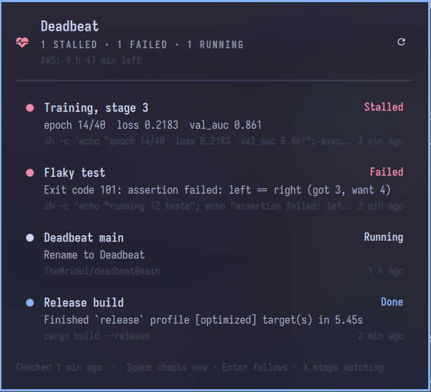

# Deadbeat

Catches your deadbeat jobs.



You (or an agent) start a training run, an export or a loop, walk away, and
come back hours later to ask "is it stuck?". Deadbeat answers before you ask.
It sends a desktop notification when a job **stalls** (its log or branch goes
quiet), finishes, fails or ends, and a small panel in the
[Omarchy](https://omarchy.org) bar shows every job at a glance.

It's two parts in one repository:

- **`deadbeat`**, a small Rust command-line tool, and a user timer that runs
  `deadbeat check` every five minutes. This part does all the watching and
  notifying, with or without a desktop.
- **The bar plugin** (`manifest.json`, `Panel.qml`), which shows the jobs. It
  reads what the tool writes and never probes anything itself.

## What it watches

| Kind | Started with | Stalled when |
|---|---|---|
| A local command | `deadbeat run --name N -- COMMAND...` | its log is quiet for `--stall` minutes (20) |
| A log on an ssh host | `deadbeat add ssh --name N --host H --log PATH [--pid PID]` | the log is quiet for `--stall` minutes (20) |
| An EC2 instance | `deadbeat add ec2 --name N --instance ID [--region R]` | never; it ends when the instance stops |
| A branch a loop pushes to | `deadbeat add git --name N --repo OWNER/REPO --branch B` | no new commit for `--stall` minutes (180) |

`deadbeat run` starts the command in its own session, so it survives the
terminal or agent that started it, and records the exit code beside its log
in `~/.local/state/deadbeat/logs/`. Remote checks use your own `ssh`, `aws`
and `gh`, each with a 60-second limit.

## Install

Build and install the tool as an Arch package, then start its timer:

```sh
git clone https://github.com/TheMridul/deadbeat && cd deadbeat/pkgbuild
makepkg -si
systemctl --user enable --now deadbeat.timer
deadbeat skill install    # teaches coding agents to use it
```

Then add the bar plugin on Omarchy:

```sh
omarchy plugin add https://github.com/TheMridul/deadbeat.git --enable
```

The plugin needs the `deadbeat` tool; without it, the panel shows how to
install it. By default the icon hides when there are no jobs.

## Remove

```sh
omarchy plugin remove io.github.themridul.deadbeat
systemctl --user disable --now deadbeat.timer
sudo pacman -R deadbeat
rm -r ~/.local/state/deadbeat ~/.agents/skills/deadbeat    # jobs, logs and the skill
```

Removing stops the watching only; jobs that `deadbeat run` started keep
running.

## Commands

Every command takes `--json`, exits 0 or 1, and writes errors to stderr.

```sh
deadbeat run --name "stage 3" --stall 30 -- python3 train.py --stage 3
deadbeat add git --name "agent loop" --repo me/lab --branch agent-loop
deadbeat check --json     # probe everything now and notify
deadbeat list --json      # last known state, no probing
deadbeat remove ID        # stop watching; the job keeps running
```

## The panel

Click the bar icon, or bind `omarchy-shell deadbeat toggle` to a key. It
shows a count while jobs run, and turns red when one stalls or fails.

| Key | Action |
|---|---|
| Space | Check every job now |
| J / K or Down / Up | Select a job |
| Enter or click | Follow its log in a terminal, or open its GitHub or AWS page |
| X / Delete | Stop watching it (U undoes, for a few seconds) |
| Esc | Close |

When [`aws-session`](https://github.com/TheMridul/dotfiles) is on the PATH,
the panel also shows how long the `aws login` session has left, because hosts
behind SSM and every AWS check stop working when it ends.

## Agents

`deadbeat skill install` puts a skill in `~/.agents/skills/deadbeat/` that
tells coding agents to start long jobs with `deadbeat run` instead of `nohup`,
and to read `deadbeat check --json` instead of polling.

## Develop

```sh
cargo test               # the tool
node --test tests/       # the plugin's model
omarchy plugin validate .
```

Needs Rust 1.89 or newer. The plugin follows Omarchy's theme and language
(English and Hindi so far; add a file to `i18n/` for more).
